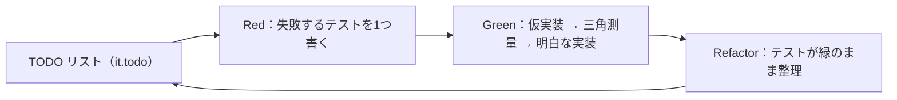

# GainLog テスト詳細設計書

## 1. 概要・前提

本書は、詳細設計フェーズの第4文書（最終）として、GainLog のテスト方式・実行基盤・配置規約・テストダブル方針・CI での実行範囲・受入条件との対応を、実装に着手できる粒度で定める。基本設計・他の詳細設計書で「`test.md` で確定する」とされた次の項目を回収する。

- `auth.md` 13章：統合テストの配置・命名規約、および CI での実行必須化の要否
- `project-structure.md` 2.1（テストファイルの配置）、4.3・8.3・8.4（CHECK 突合・トリガー存在・シード前提のテスト）、6.3・13章 未解決4（Vitest のプロジェクト分割と Cloudflare プラグインの除外）、13章 未解決14
- `backend.md` 15章 未解決7（ユースケースのテスト方針、リポジトリの実 D1 テスト、競合の再現要否、所有者チェック横断テストの対象一覧）
- `frontend.md` 2.2・9章・12章・17章 未解決4・7（コンポーネントテストの範囲、`lib/date.ts` の時刻固定、E2E の対象シナリオ・実行タイミング・CI への組み込み）
- ADR-0011（シード前提・名前重複なし・CHECK 突合）、ADR-0013（ポートの差し替え）、ADR-0017（E2E の対象・タイミング・テストダブル）
- `requirement.md` 8章の受入条件との対応表

対象読者は開発者本人（実装者）である。粒度は「規約・責務・主要フロー・選定理由」までとし、個々のテストケースの全列挙や設定ファイルの全文は実装（TDD）で詰める。対象は Phase 1 のみ。

### 前提（引き継ぐ確定事項）

| 項目 | 内容 | 出所 |
|---|---|---|
| 開発手法 | t-wada 流 TDD（テストファースト／Red-Green-Refactor／TODO リスト駆動／三角測量） | `CLAUDE.md` |
| テストの隣置き | テストファイルは対象の隣に `*.test.ts(x)` として置く（暫定。本書 9章で確定） | `project-structure.md` 2.1 |
| Vitest の3プロジェクト | api（Workers 環境）／client（DOM 環境）／shared（Node 環境）。Worker 用プラグインを client・shared に読み込ませない | `project-structure.md` 6.3 |
| ポートの差し替え | `domain/ports` の抽象を介して、ユースケースのテストでは具象を差し替える | ADR-0013、`backend.md` 2.1 |
| D1 はモックしない | リポジトリ・統合テストはローカルの実 D1 を使う。migration 適用後はシード（事前定義種目18件）とトリガーが入っている | ADR-0011、`project-structure.md` 8.4 |
| 表示部品は props のみに依存 | ローディング・空・エラー等の状態を props の差し替えだけで再現できる | `frontend.md` 2.2 |
| 時刻の注入点 | api は `Clock` ポート、client は `lib/date.ts`、shared は「現在時刻を引数で受け取る純関数」 | `backend.md` 7.3、`frontend.md` 9章、`project-structure.md` 4.1 |
| E2E は Playwright | CI に組み込む。対象・タイミングは本書で確定する | ADR-0017 |
| 所有者チェックの最終防御線 | 他ユーザーのリソース ID でのアクセスが 404 になることを統合テストで保証する | `auth.md` 8・13章 |

### 本書で新たに確定する事項

| 項目 | 確定内容 | 章 |
|---|---|---|
| API の実行基盤 | `@cloudflare/vitest-plugin`（workerd 上・ローカル D1）＋ Vitest 5。ADR-0018 | 4章 |
| クライアントの実行基盤 | jsdom ＋ React Testing Library ＋ `user-event` ＋ `jest-dom` | 4・6章 |
| クライアントの API 差し替え | MSW（`msw/node`）。`hc`／`unwrap` を含む本物の経路を通す | 6章 |
| TDD の運用 | TODO リストは `it.todo`。コミットは Green 単位と Refactor 単位（Red はコミットしない） | 2章 |
| API 統合テストの配置 | `interface/routes/*.routes.test.ts`（routes の隣）。所有者チェック横断のみ `interface/ownership.test.ts` に集約 | 5・9章 |
| E2E の認証 | ローカル D1 に users／sessions を直接 INSERT し、生トークンを `__Host-session` Cookie として注入する。本番コードにテスト用の分岐を置かない。ADR-0019 | 7章 |
| E2E の実行 | PR ごとに CI で実行（主要5シナリオ＋モバイル viewport）。デプロイのブロック要件にはしない | 7・10章 |
| カバレッジ | 計測のみで閾値は設けない | 10章 |
| 非機能の受入条件 | 性能目標・実機スマホは手動確認手順として定義する | 12章 |

### 導入するテスト用ライブラリ・版（`requirement.md` 6章への追記対象）

バージョンは 2026-10-10 時点の npm（`npm view`）で確認したもので、実装時に再確認する。`requirement.md` 6章に明記のないものは、本書の確定に合わせて 6章へ追記する（`CLAUDE.md` の合意ルール）。

| 区分 | ライブラリ | 確認したバージョン | 備考 |
|---|---|---|---|
| テストランナー | `vitest` | 5.0.3（peer: `vite ^6.4 \|\| ^7 \|\| ^8`） | 6章に Vitest は記載済み。版を本書で確定 |
| Workers 環境のテスト | `@cloudflare/vitest-plugin` | 1.4.0（peer: `vitest ^4.1 \|\| ^5`。依存: `wrangler 4.149.0`） | ADR-0018。旧名 `@cloudflare/vitest-pool-workers` の後継 |
| DOM 環境 | `jsdom` | 30.1.2 | |
| コンポーネントテスト | `@testing-library/react` | 16.3.3（peer: `@testing-library/dom ^10`、`react`・`react-dom` ^18 \|\| ^19） | pnpm の厳格な依存解決のため、`@testing-library/dom` を明示的に依存へ加える |
| | `@testing-library/dom` | 10.x（上記の peer） | |
| | `@testing-library/user-event` | 14.6.7 | |
| | `@testing-library/jest-dom` | 7.0.1（peer: `@testing-library/dom >=10 <11`） | |
| API のモック（client） | `msw` | 3.0.3（peer: `vite >=6`、`typescript >=5.9`） | |
| カバレッジ | `@vitest/coverage-v8` または `@vitest/coverage-istanbul` | 5.0.3（`vitest` と同一版が必須） | プロバイダは 10章・15章 未解決 |
| E2E | `@playwright/test` | 1.64.0 | ADR-0017。`frontend.md` 1章で記載済み |

- `@msw/cloudflare`（Worker 内の外向き `fetch` のモック）は採用しない。Google への外向き呼び出しは、`GoogleOAuthClient`・`IdTokenVerifier` を fake に差し替える方針とする（8章。ADR-0018）。
- 参考：`project-structure.md` 1章の表にある wrangler（4.135.0）・`@cloudflare/vite-plugin`（1.56.0）は 2026-09-20 時点の値で、2026-10-10 時点では wrangler 4.149.0・`@cloudflare/vite-plugin` 1.63.1（peer: `wrangler ^4.149.0`）である。実装時に再確認して揃える（15章）。

## 2. TDD の進め方

### 2.1 サイクル

| 手順 | 規約 |
|---|---|
| TODO リスト | 着手前に、対象の機能で必要なテストケースを、テストファイルに `it.todo('...')` として列挙する。未着手の項目がテスト結果（`todo` 件数）に表示され、リストと実装の乖離が見える。思いついた追加ケースも `it.todo` として足す |
| Red | `it.todo` を1つ選び、本物のテストに書き換えて失敗させる。**失敗の理由が意図どおりであること**（想定外のコンパイルエラー・設定ミスでないこと）を確認する |
| Green | 次の順で最小の変更で通す。①仮実装（定数を返す）→ ②三角測量（別の入力のテストを足して一般化を迫る）→ ③明白な実装（自明なら直接書く）。**自明でない箇所ほど刻む** |
| Refactor | 緑のまま重複・命名を整理する。テスト側のリファクタ（ビルダーへの抽出等）もここで行う |

- 例：重量の変換（`frontend.md` 8.3 の表）は、`"60"→600` で仮実装 → `"60.5"→605` で小数部を一般化 → `"999.9"` ・`"0"` で境界、の順に三角測量する。
- 「次に書くテスト」は、最も単純なケース（空・0件・正常系）から始め、異常系・境界へ進める。

### 2.2 コミット単位

- **コミットは Green 単位（「テスト＋それを通す実装」）と Refactor 単位**とする。**Red の状態（失敗するテスト）はコミットしない**。CI が落ちるためと、Conventional Commits の 1 コミット 1 目的（`CLAUDE.md`）を保つため。
- `it.todo` の追加のみのコミットは許容する（`todo` は失敗にならない）。
- pre-commit（`project-structure.md` 9.2）は lint・format・型・シークレット等であり、**テストは実行しない**。テストの実行は手元（`pnpm test`）と CI の責務とする。したがって Red を誤ってコミットしても pre-commit は止めないため、コミット前に `pnpm test` が緑であることを開発者が確認する。
- コミットメッセージは `feat:`／`fix:`／`refactor:`／`test:` を内容に応じて使い分ける。テストのみの追加（既存実装の仕様固定・回帰テスト）は `test:`。

### 2.3 バグ修正時

先に再現するテストを書いて Red にし、修正して Green にする（回帰テスト）。テストを足さずに修正だけをコミットしない。

## 3. テストサイズとレイヤー別方針

| サイズ | 定義 | 対象 | 実行基盤 |
|---|---|---|---|
| Small | プロセス内で完結。外部リソース（DB・ネットワーク）に触れない | shared の純関数・スキーマ、api の domain・ユースケース、client の表示部品・ユーティリティ | Vitest（shared＝Node、api＝Workers 環境、client＝jsdom） |
| Medium | 実 D1 または HTTP 境界（MSW）を通す。ブラウザなし | api のリポジトリ・DB 構造・API 統合（ミドルウェア〜ルート〜D1）、client のフック・認証ガード（MSW） | Vitest |
| Large | 実ブラウザ＋ビルド成果物＋ローカル D1 | E2E（主要シナリオ） | Playwright |

下位のサイズほど数を多くする（ピラミッド）。上位でしか検出できないもの（トリガー・実 D1 の制約・Cookie・ブラウザの `<dialog>`）だけを上位に置く。

### 3.1 レイヤー別の対応

| 層・領域 | テストの種類 | サイズ | 主な観点 |
|---|---|---|---|
| `src/shared` | 単体 | Small | 制約値・Zod スキーマ・`fields` 変換・重量変換・JST 日付ユーティリティ |
| `src/api/domain` | 単体 | Small | ドメインエラー・モデルの不変条件（外部依存がないため差し替え不要） |
| `src/api/application` | 単体（ポートを fake に差し替え） | Small | `CompleteLoginUseCase`・`AddExerciseBlockUseCase` の分岐 |
| `src/api/infrastructure/repositories` | リポジトリ（実 D1） | Medium | `userId` による所有者絞り込み、制約違反 → `ConflictError`、自己ベスト SQL |
| `src/api/infrastructure/db` | DB 構造（実 D1） | Medium | CHECK・UNIQUE・FK、トリガー、シード |
| `src/api/infrastructure/auth` | 単体（ローカル鍵） | Small | ID トークン検証（署名・iss・aud・exp・nonce） |
| `src/api/interface` | API 統合（実 D1、外部境界のみ fake） | Medium | ミドルウェア順序・エラー変換・認証フロー・所有者チェック横断 |
| `src/client`（表示部品・`components/ui`） | コンポーネント（props 差し替え） | Small | 各状態の描画・操作コールバック・フォーカス |
| `src/client`（`use*.ts`・認証ガード・`lib`） | フック（MSW） | Medium | 通信・401 横断処理・invalidate・インラインエラー |
| アプリ全体 | E2E | Large | 受入条件の主要導線 |

- `pages/*.tsx` は薄い組み立てのみ（`frontend.md` 2.1）のため、**専用のテストは書かない**。振る舞いは「フックのテスト」「表示部品のテスト」「E2E」の合成で担保する。ただし `AuthenticatedLayout`／`RequireAuth`（ルーティングの分岐を持つ）は Medium のテスト対象とする。
- **テストしないもの**：Tailwind のクラス名・スタイル・レイアウト、`wrangler.jsonc` の設定値そのもの、サードパーティの内部挙動（Hono・Drizzle・TanStack Query の実装）。

## 4. テスト実行基盤

### 4.1 Vitest のプロジェクト構成

ルートの `vitest.config.ts` で、`projects` により3つに分ける。

| プロジェクト | 環境 | 対象 | 備考 |
|---|---|---|---|
| `shared` | Node | `src/shared/**/*.test.ts` | 副作用なし。最速 |
| `api` | Workers（workerd。`@cloudflare/vitest-plugin`） | `src/api/**/*.test.ts` | ローカル D1 に migration 適用済み。`wrangler.jsonc` のバインディングを使う |
| `client` | jsdom | `src/client/**/*.test.{ts,tsx}` | RTL・MSW・`jest-dom` を setup ファイルで登録 |

- **`vitest.config.ts` は `vite.config.ts` を継承せず、独立して定義する**（`project-structure.md` 6.3「Worker 用プラグインを client・shared に読み込ませない」・未解決4 の回収）。`vite.config.ts` は `@cloudflare/vite-plugin` を含むため、継承すると jsdom／Node のテストに Worker 用プラグインが入ってしまう。
- ただし `@shared` エイリアスと React プラグイン（JSX 変換）は、`vitest.config.ts` の各プロジェクトに同じ定義を置く（エイリアスの定義元は 1 箇所の定数にして共有する。重複定義によるずれを避ける）。
- テストファイルの種別は拡張子で振り分ける（`*.test.ts` は api／shared、`*.test.tsx` は client が中心）。`include` はディレクトリ（`src/api`・`src/client`・`src/shared`）で分け、拡張子では分けない。

### 4.2 api プロジェクト（Workers 環境・ローカル D1）

- 実装は workerd 上で実行され、本番と同じランタイムで `crypto.subtle`・`crypto.randomUUID()`・D1 バインディングが動く。
- **migration の適用**：Node 側（設定ファイル）で `readD1Migrations('migrations')`（`@cloudflare/vitest-plugin/config`）により `migrations/` を読み込み、setup ファイル（Workers 環境側）で `applyD1Migrations(env.DB, migrations)`（`cloudflare:test`）を実行する。シード・トリガーも migration のため、**適用後は「事前定義種目18件＋トリガー5本」が入った状態がテストのベースライン**になる（ADR-0011）。migrations ディレクトリの内容を直接使うため、本番と同一の SQL が検証される。
- **データ分離の規約（ストレージ分離に依存しない）**：D1 のテスト間のストレージ分離の挙動は公式ドキュメントで確認できなかったため（15章 未解決1）、次の規約でテストを成立させる。
  1. 各テストは**自分でユーザー（と必要なデータ）をビルダーで作り**、他のテストのデータの有無に依存しない（9.3）。
  2. 件数の検証は**グローバルに数えない**。「自分の `userId` に属する行」に限定する。
  3. シード（事前定義種目）を変更・削除するテストは書かない。シードの検証（8.4 相当）は読み取りのみ。
  4. `reset()`（全バインディングのデータ削除）は**使わない**。シードごと消えるため。
- テストごとに固有の ID（`crypto.randomUUID()`）を使うため、同一ファイル内・ファイル間のデータは衝突しない。

### 4.3 client プロジェクト（jsdom）

- setup ファイルで `@testing-library/jest-dom` の拡張、`msw/node` のサーバー起動（`onUnhandledRequest: 'error'`）、各テスト後の `cleanup`・ハンドラのリセットを行う。
- `QueryClient` は**テストごとに新規作成**する（キャッシュの持ち越しを避ける。`retry: false` は本番設定と同じ。`frontend.md` 5.1）。レンダーヘルパーは `src/client/testing/` に置く（9.2）。
- `<dialog>` の `showModal()` が jsdom で動作するかは未確認（15章 未解決2）。動かない場合は、setup で最小のスタブを入れるか、ダイアログの開閉検証を E2E に寄せる。

### 4.4 npm scripts（`project-structure.md` 10章の `test` 行を具体化）

| script | 内容 |
|---|---|
| `test` | `vitest run`（全 projects。CI と同じ） |
| `test:watch` | `vitest`（TDD の開発中に使う。対象プロジェクトの絞り込みは Vitest の `--project` を使う） |
| `test:coverage` | `vitest run --coverage`（10.3） |
| `e2e` | `playwright test`（7章。`frontend.md` 12.3 の行の具体化） |

## 5. バックエンドのテスト

### 5.1 domain・ユースケース（Small）

- `domain`：外部依存を持たないため、差し替えなしで単体テストする。
- **ユースケースはポートを in-memory の fake に差し替える**（ADR-0013）。fake のリポジトリは `src/api/testing/` に置く（9.2）。
- `CompleteLoginUseCase` の観点：`email_verified: false` → 失敗／allowlist 外 → `NotAllowedError`／初回ログインで users を作成／既存 `sub` で email を更新（email 変更の追従）／毎回新規のセッション行を作成／戻り値は生トークン（DB 保存値はハッシュ）。
- `AddExerciseBlockUseCase` の観点：見えない種目（存在しない・他人の追加種目）→ `NotFoundError`／同日同種目の既存ブロック → `ConflictError`／記録が未作成の日 → 記録とセットを作成／記録が既存で別種目のみ → セットのみ追加。
- 時刻・ID は fake の `Clock`・`IdGenerator`（固定値・連番）を注入し、**生成された ID・時刻を厳密に検証できる**ようにする。

### 5.2 リポジトリ（Medium・実 D1）

配置は実装の隣（`src/api/infrastructure/repositories/<name>.d1.test.ts`）。リポジトリごとに次の観点を持つ。

| 観点 | 内容 |
|---|---|
| 所有者による絞り込み | ユーザー A のデータが、ユーザー B の `userId` では**取得・更新・削除のいずれもできない**こと（`WorkoutRecord`・`WorkoutSet`・ユーザー追加 `Exercise`）。`backend.md` 6.2 の表の行ごとに1ケース以上 |
| 事前定義種目の可視性 | 全ユーザーから見える（一覧・個別）。編集・削除の可否は 5.5 の API 統合側で確認し、リポジトリでは `owner_user_id IS NULL` の判別を返せること |
| 制約違反 → `ConflictError` | UNIQUE（`(owner_user_id,name)`・`(user_id,workout_date)`・`(workout_record_id,exercise_id,set_number)`）と RESTRICT（使用中種目の削除）が `ConflictError` に変換される。**エラーの判別パターン（エラーメッセージ・コード文字列）はここで実測して固定する**（`backend.md` 15章 未解決1 の回収。実装フェーズ最初のタスク） |
| 自己ベスト（`findBestSet`） | `db.md` 8章の確定 SQL の仕様を表で固定する（5.2.1） |
| 日付範囲の集計（`summarizeByDateRange`） | 範囲の両端を含む／範囲外を含まない／セット0件の記録は存在しない（トリガーにより自動削除済み）／他ユーザーの記録を含まない |
| `batch()` の原子性 | `upsertAndAddSets` の途中（2文目）で制約違反が起きたとき、1文目（`workout_records` の INSERT）もロールバックされ、孤立した記録が残らないこと |

**5.2.1 自己ベスト（`findBestSet`）のケース**

| ケース | 期待 |
|---|---|
| その種目の記録が1件もない | 0件（`found: false` 相当） |
| 記録が編集対象の1件のみ（`excludeRecordId` で除外される） | 0件 |
| 複数日で最大重量が異なる | 最大重量を含む日の**全セット**を返す（最大セットだけではない） |
| 同一最大重量が複数日にまたがる | **より新しい `workout_date` の日**を返す（タイブレーク。`requirement.md` 5.2） |
| 最大重量の日が未来日 | 含めて集計する（`requirement.md` 5.2「未来日を含む」） |
| `excludeRecordId` を指定 | 該当記録を除いた中で最大を探す（編集中の記録自身の重量で自己ベストが埋まらない） |
| 他ユーザーの記録に、より重いセットがある | 影響しない |
| 他の種目に、より重いセットがある | 影響しない |

### 5.3 DB 構造（Medium・実 D1）

配置は `src/api/infrastructure/db/` の隣（`constraints.test.ts`・`triggers.test.ts`・`seed.test.ts`）。**本番の migration が実際に作る DB の構造を、振る舞いで検証する**。

| テスト | 内容 | 回収する宿題 |
|---|---|---|
| **制約の突合**（`constraints.test.ts`） | `db.md` 6章の制約一覧の行ごとに、違反する INSERT／DELETE が失敗することを確認する（CHECK：`category` 8値外・`weight_deci` が -1 と 10000・`reps`／`set_number` が 0・`workout_date` の形式違反、UNIQUE 3種＋`google_sub`・`allowlist.email`（大文字小文字違いも拒否）、FK の CASCADE／RESTRICT）。合わせて `sqlite_master` の定義文に `CHECK` が含まれることも確認する（Drizzle の `text({ enum })` は CHECK を生成しないため。`project-structure.md` 4.3） | `project-structure.md` 4.3、ADR-0011 |
| **境界値** | `weight_deci` は 0 と 9999 が通り、-1 と 10000 が拒否される。`reps`・`set_number` は 1 が通り 0 が拒否される | `requirement.md` 5.1 |
| **トリガーの存在**（`triggers.test.ts`） | `sqlite_master` に、`updated_at` 自動更新4本と `trg_workout_records_auto_delete` の**計5本が存在する**こと。テーブル再作成を含む migration の後でもトリガーが残ることを保証する（`project-structure.md` 8.3） | `project-structure.md` 8.3、ADR-0011 |
| **トリガーの挙動** | ①最後のセットを削除すると `workout_records` が自動削除される ②セットが残っていれば削除されない ③日単位削除（`workout_records` の直接 DELETE）で CASCADE が走っても整合が保たれる（冗長な DELETE が発生しても失敗しない。`db.md` 7章の「D1 上で挙動を確認する」の回収）④`updated_at` が UPDATE で更新される／明示値は上書きしない | `db.md` 7章 |
| **シード**（`seed.test.ts`） | 事前定義種目が**18件**あること、`owner_user_id IS NULL`、カテゴリが8値のいずれか、`other` が0件、**名前に重複がない**こと（`UNIQUE(owner_user_id,name)` は NULL 同士を防げないため。ADR-0011）。`backend.md` 12章の UUID が固定値で存在すること | `backend.md` 12章、ADR-0011 |

- 「テーブル再作成で親行が消えるか」（`project-structure.md` 13章 未解決2）は、再作成を含む migration を実際に書く段階でこの層に回帰テストを足す。**現時点で再作成を伴う migration は存在しないため、設計書上は未解決事項のまま残す**（15章）。

### 5.4 ID トークン検証（Small）

- `GoogleIdTokenVerifier`（`infrastructure/auth`）は、**ローカルで生成した鍵ペアで署名したトークン**を検証対象とする。JWKS の取得元をコンストラクタで差し替えられる形にする（本番は `createRemoteJWKSet`＋ハードコードの `jwks_uri`、テストは `createLocalJWKSet` 相当。`backend.md` 5.1 への追従が必要。14章）。
- 観点：正常／署名不正／`iss` が `https://accounts.google.com` と `accounts.google.com` のどちらでも通る／`iss` 不正／`aud` 不正／期限切れ／`nonce` 不一致／必須クレーム（`sub`・`email`・`email_verified`）の欠落。`requirement.md` 8章「state・nonce・ID トークン（署名・issuer・audience・有効期限）が検証される」の中核を担う。

### 5.5 API 統合テスト（Medium）

**配置と命名**：`src/api/interface/routes/<resource>.routes.test.ts`（routes の隣。`auth.routes.test.ts`・`exercises.routes.test.ts`・`records.routes.test.ts`）。ミドルウェアは `src/api/interface/middleware/<name>.test.ts`。所有者チェック横断のみ `src/api/interface/ownership.test.ts`（5.6）。

- アプリ全体（ミドルウェア〜ルート〜リポジトリ〜実 D1）を、`app.request()`（Hono のテスト用ヘルパー）で呼び出して検証する。
- **差し替えるのは外部境界のみ**：`IdTokenVerifier`・`GoogleOAuthClient`（Google の token endpoint 呼び出し）。`Clock`・`IdGenerator`・リポジトリは**本物を使う**。時刻に依存する観点（セッションの無操作・絶対期限）は、**DB に過去の時刻を持つセッション行を直接 INSERT する**ことで再現する（`Clock` を差し替えない）。
- そのため、アプリ生成を関数化して外部境界を差し替え可能にする（`createApp({ idTokenVerifier, googleOAuthClient })`。`export default` は本番の組み立て、`AppType` は `ReturnType<typeof createApp>`。`backend.md` 3.1 への追従が必要。14章）。
- 認証済みリクエストは、ビルダーで users・sessions を作り、生トークンを `Cookie: __Host-session=<token>` として付ける（ログインフローを毎回通さない）。
- 状態変更系には `Content-Type: application/json` と `Sec-Fetch-Site: same-origin` を付けるヘルパーを用意する（付けないケースは専用テストで確認）。

**観点（全エンドポイントで確認する共通事項）**

| 観点 | 内容 |
|---|---|
| 正常系 | ステータス・レスポンス本文の主要項目（camelCase の形。`weightDeci` は整数） |
| バリデーション | 不正な入力で 400 ＋ `fields`（`{ field, message }`）。メッセージは `shared` の定数と一致する（API・UI で同一文言。`common-spec.md` 3章）。JSON 構文エラーも 400（`fields` なし） |
| 暦日の検証 | `2026-02-30` 等が 400（DB の CHECK は形式のみで暦日を見ないため、アプリ層が最終防御線。`backend.md` 9章） |
| 認証 | Cookie なし・無効トークンで 401。共通エラー形式（`{ code, message }`） |
| エラー変換 | UNIQUE／RESTRICT → 409、見えない／他人のリソース → 404、事前定義種目の編集・削除 → 403、想定外の例外 → 500（内部情報を漏らさない）。`code` と HTTP ステータスの 1 対 1 対応（ADR-0006） |
| 未定義パス | `/api/unknown` が JSON の `not_found`（404）。HTML を返さない（`backend.md` 3.2） |

**エンドポイント固有の主な観点**

| 領域 | 観点 |
|---|---|
| 認証フロー（`auth.routes.test.ts`） | ①`/login`：`__Host-oauth_txn` を発行（HttpOnly・Secure・SameSite=Lax・Path=/・Domain なし）し、Google の認可 URL へ 302（`state`・`nonce`・`redirect_uri` を含む）②redirect URI は origin の許可リスト外なら `invalid_request`（`backend.md` 5.3）③`/callback`：`state` 不一致・Cookie 欠落 → `/login?error=invalid_request`／ID トークン不正 → `invalid_token`／allowlist 外 → `not_allowed`／成功 → セッション Cookie 発行＋302 `/`。一時 Cookie が失効される ④成功時、DB に保存されるのは**生トークンではなくハッシュ**（SHA-256 の16進数）⑤`/logout`：204、**存在しないセッションでも 204（冪等）**、以後同じ Cookie で 401 ⑥`/me`：認証済みで 200、未認証で 401 |
| セッション（`session-auth.test.ts`） | 無操作24時間超過 → 401＋行の削除／絶対30日超過 → 401＋行の削除（`last_accessed_at` が新しくても絶対期限は延長されない）／`last_accessed_at` の更新が5分未満では行われず、5分以上経過していれば更新される |
| CSRF（`sec-fetch-site.test.ts`・`json-content-type.test.ts`） | 状態変更 API で `Sec-Fetch-Site: cross-site` → 403、`same-origin`・`none`・ヘッダ欠落 → 通過。`Content-Type` が JSON でない → 拒否。`GET /api/auth/login`・`/callback` は対象外（`backend.md` 4章） |
| 種目（`exercises.routes.test.ts`） | 一覧に事前定義＋自分の種目のみ／名前重複 → 409／事前定義の編集・削除 → 403／使用中の削除 → 409／他人の種目 → 404／`best-set`（5.2.1 の結果が API 経由で返る。`excludeDate` に該当記録がなければ除外なし） |
| 記録（`records.routes.test.ts`） | 記録のない日の `GET /records/{date}` は **200 で `exercises: []`**／`POST /records/{date}/exercises` の同日同種目重複 → 409、見えない種目 → 404／3粒度の削除（日・種目・セット）と、**セット0件化による記録の自動削除**（カレンダーに空の記録日が出ない：`GET /records` に含まれない）／`set_number` の重複 → 409／`PATCH` で `set_number` を重複値に変更 → 409／`from > to` → 400 |

### 5.6 所有者チェック横断テスト（`ownership.test.ts`）

`auth.md` 8・13章の「最終防御線」。ユーザー A のリソースに対し、ユーザー B のセッションでアクセスし、**存在を漏らさない応答**になることをテーブル駆動で確認する。

| 対象（`backend.md` 6.2） | 期待 |
|---|---|
| `WorkoutRecord`（日単位の取得・削除） | 404（記録が存在しない日と区別がつかない応答。取得は 200＋空配列の仕様に注意し、削除は 404） |
| `WorkoutSet`・種目ブロック（追加・編集・削除） | 404 |
| ユーザー追加 `Exercise`（`PATCH`・`DELETE`・`best-set`） | 404 |
| 事前定義 `Exercise`（`PATCH`・`DELETE`） | **403**（全ユーザーに可視のため。404 ではない） |

- **網羅性の自動検査**：アプリのルート一覧（`app.routes`）から全エンドポイントを列挙し、「所有者チェック対象表」または「対象外（認証・一覧等）の明示リスト」のどちらかに必ず含まれていることを検査するテストを置く。**エンドポイントを追加したのに横断テストへ追加し忘れると、このテストが失敗する**（`auth.md` 13章「実装ミスを検知する最終防御線」の実効性を保つため。`OpenAPIHono` から `app.routes` を列挙できるかは実装時に確認する。15章 未解決3）。
- 併せて、**未認証での全 `/api/*`（`/auth/login`・`/auth/callback` を除く）が 401** になることも同じ列挙で確認する。
- ユーザー A・B はビルダーで作り（9.3）、B のリクエストが**A のデータを一切変更していない**ことも、A のデータを再取得して確認する（404 を返しつつ書き込みが走っていた、という実装ミスを検出するため）。

### 5.7 競合の扱い

`AddExerciseBlockUseCase` の「読み取り → batch 書き込み」の間に別リクエストが割り込む競合（`backend.md` 7.1）は、**再現するテストを書かない**。実質1ユーザーの利用規模で発生確率が極めて低く、再現にはテスト基盤の制御が過大になるため。代わりに、**最終防御線である UNIQUE 違反が 409 に変換されること**を 5.2・5.5 で確認する。

## 6. フロントエンドのテスト

### 6.1 shared（Small・Node）

`src/shared` は workerd・DOM のいずれにも依存しないため、Node 環境で最速に回す。TDD の最初の題材になる領域でもある。

| 対象 | 観点 |
|---|---|
| 制約値・Zod スキーマ | 重量（0・999.9・範囲外）、`reps`・`set_number`（1 以上の整数、上限なし）、カテゴリ8値、日付（`YYYY-MM-DD`＋暦日の妥当性：`2026-02-30`・うるう年の `2028-02-29`）、種目名（空・長さ） |
| 重量の変換（`frontend.md` 8.3） | 同章の表の全行をそのままテーブル駆動のテストにする（`"0"→0`、`"60"→600`、`"60.5"→605`、`"999.9"→9999`、`"60."`・`"1.25"`・`"-1"`・`"1000"`・空・非数値はエラー）。**浮動小数点を経由しない**ことの確認として、`"0.1"`・`"0.7"`・`"1.1"` 等、2進浮動小数点で誤差が出やすい値が正確な整数になること。`weightDeci → kg 文字列` の逆変換も同様 |
| `fields` 変換 | Zod のエラー → `{ field, message }` 配列。ネストしたパス・複数エラーの順序。API と UI が同じ関数を使うため、ここで一度確認すれば足りる |
| JST 日付ユーティリティ | 現在時刻を引数で受け取る純関数のため、**時刻を直接渡して**検証する（fake timer 不要）。観点：UTC と JST で日付がずれる境界（UTC 15:00 = JST 翌 0:00 の前後）、月の範囲（28・29・30・31日、年またぎ）、直近7日間のローリングウィンドウ（当日を含む過去7日。月またぎ・年またぎ） |
| エラーコードと HTTP ステータスの対応 | 6値が `common-spec.md` 2章の表と一致する（ADR-0006） |

### 6.2 表示部品・共通 UI（Small・jsdom）

`frontend.md` 2.2 のとおり、表示部品は props（データ・コールバック）のみに依存するため、**ネットワーク・MSW なしで**描画できる。

| 対象 | 観点 |
|---|---|
| `RecordEditor`・`ExerciseBlock`・`SetRow` | ローディング／空（記録なし）／エラー表示の各状態、表示モードと編集モードの切替（入力欄の出し分け）、「保存」押下で正しい引数のコールバックが呼ばれる、更新中のボタンが `disabled`（二重送信防止。`common-spec.md` 5章） |
| `BestSetPanel` | `found: true` で日付と全セット（重量・回数・セット番号）を表示／`found: false` で「この種目の記録はまだありません」（`screens.md` 6章の文言） |
| フォーム入力 | `type="text" inputMode="decimal"` の重量欄で、送信時に検証し、エラーが出たフィールドは以後の変更ごとに再検証して解消でエラーが消える（`frontend.md` 8.2）。エラーが出ていない欄は入力中に赤字にならない。API 由来の `fields` も同じインラインエラーに流れる |
| `ConfirmDialog` | **既定フォーカスが「キャンセル」**であること（`screens.md` 6章）、確定・取消でそれぞれ正しいコールバック。3粒度（日・種目・セット）の確認文言 |
| `AddExerciseDialog` | **当日の記録に既に含まれる種目が選択肢から除外**される（`frontend.md` 7.4、D14） |
| `Toast` | `aria-live="polite"` の領域に `message` が出る |
| 種目一覧 | 事前定義種目に編集・削除ボタンが**出ない**、カテゴリ別のグルーピング |

- クエリは `getByRole`・`getByLabelText` を優先する（アクセシビリティに即した選択。実装の内部構造に依存しない）。操作は `user-event` を使う（`fireEvent` は使わない）。
- スナップショットテストは使わない（変更のたびに更新が必要になり、意図が読み取りにくいため）。

### 6.3 フック・認証ガード（Medium・MSW）

`features/*` の `use*.ts` と `AuthenticatedLayout`／`RequireAuth`、`lib/api.ts`・`lib/queryClient.ts` を、**`hc`／`unwrap`／TanStack Query を含む本物の経路**で、ネットワーク境界だけを MSW で差し替えてテストする。

| 対象 | 観点 |
|---|---|
| `lib/api.ts`（`unwrap`） | 2xx で本文を返す／204 で `undefined`／非 2xx で `ApiError`（`status`・`code`・`message`・`fields`）／本文が JSON でない非 2xx は `internal_error`＋汎用文言／`fetch` 失敗（`HttpResponse.error()`）で `network_error`（`status` 0） |
| 401 の横断処理（`queryClient`） | クエリ・ミューテーションのどちらで 401 を受けても、`queryClient.clear()` を呼び `/login` へ遷移する。**すでに `/login` にいる場合は遷移しない**。`location.assign` は spy に差し替えて検証する（jsdom のナビゲーションは実行されないため） |
| 認証ガード | `/me` が 200 → 子ルートを表示／401 → `/login` へ `Navigate`／ローディング中は全画面スピナー／**401 以外のエラーも未認証と同様にログイン画面へ**（`frontend.md` 3.2）。`LoginPage` は認証済みなら `/` へ |
| `:date` の検証 | `/records/2026-02-30`・`/records/abc` で **API を呼ばずに** `NotFoundPage` の内容を表示（MSW のハンドラが呼ばれないことを確認） |
| ミューテーション → invalidate（`frontend.md` 5.3 の表） | 表の行ごとに、成功後に**該当するクエリが再取得される**こと（MSW の呼び出し回数・順序で検証）。セット追加・種目ブロック追加・各種削除で記録・サマリ・自己ベストが再取得される／種目の追加で `['exercises']` のみ。**セット0件化の後は、再取得により `exercises: []` の空編集状態へ収束する** |
| エラー表示の分岐（`frontend.md` 6章） | 400 → インライン（トーストなし）／403・404・409 → トーストで `message`／500・`network_error` → 汎用文言のトースト／401 → トーストなし |
| ログアウト | 成功後に `queryClient.clear()` → `/login`。失敗しても（冪等のため）同様に遷移する |
| `ログイン画面の error クエリ` | `invalid_request`・`invalid_token`・`not_allowed` が固定文言にマッピングされ、**未知の値や `<script>` を含む値は描画されない**（XSS 対策。`frontend.md` 7.1・13.1） |

- MSW のハンドラは `src/client/testing/` に API の形（`shared` の型）に沿った**ファクトリ**として置き、テストごとに必要な分だけ `server.use()` で上書きする。`onUnhandledRequest: 'error'` により、想定外のリクエストを見逃さない。
- MSW のレスポンスの形が実際の API とずれていくリスクは、**ハンドラの戻り値を `shared` の Zod スキーマ（レスポンス）で `parse` する**ことで抑える（ずれたらテストが落ちる）。API 側の統合テストが実際の形を保証するため、両者が `shared` を介して一致する。

### 6.4 時刻の固定（`frontend.md` 9章の回収）

- client で現在時刻を取得するのは `lib/date.ts` の1点のみ（`frontend.md` 9章）。**テストではこのモジュールの「今」を返す関数を `vi.mock` で固定値に差し替える**。
- `vi.useFakeTimers` は使わない。TanStack Query・MSW・`user-event` の非同期処理と干渉し、テストが不安定になりやすいため。
- shared の JST 純関数には時刻を引数で直接渡す（6.1）ため、差し替えは不要。

## 7. E2E テスト（Playwright）

ADR-0017 の採用を受け、`frontend.md` 12章の「対象シナリオ・実行タイミング・テストダブルの方針は `test.md` で確定する」を回収する。位置づけは、**受入条件の主要導線を実ブラウザ・ビルド成果物・実 D1 で通す最上位の確認**であり、下位のテストで保証できない項目（`<dialog>`・Cookie・ルーティング・レスポンシブ）に集中する。件数は絞る。

### 7.1 配置と実行対象

| 項目 | 内容 |
|---|---|
| 配置 | リポジトリ直下の `e2e/`（`e2e/*.spec.ts`、補助は `e2e/support/`）と、`playwright.config.ts`。Vitest の `include` には含めない |
| 実行対象 | **ビルド成果物**（`vite build` → `vite preview`。`project-structure.md` 6章）に対して実行する。本番相当のバンドル・Static Assets・workerd 上の Worker で検証するため。開発サーバでは実行しない |
| サーバー起動 | Playwright の `webServer` で `pnpm db:reset:local && pnpm build && pnpm preview` を起動し、起動待ちを行う（migration 適用後のローカル D1＝シード入りの状態から開始） |
| プロジェクト | `desktop`（Chromium）と `mobile`（Chromium＋モバイルの viewport・タッチ。デバイスプリセットの例：Pixel 7）。Safari（WebKit）は Phase 1 では対象外とし、実機確認（12章）で補う |
| 並列度 | 初期は `workers: 1`・`fullyParallel: false`。D1 のローカルファイルへの書き込みを単純に保つため（15章 未解決5）。安定後に見直す |

### 7.2 認証（ADR-0019）

Google ログインは実際には通せないため、**セッションを直接用意する**。

1. テストごとに、固有の `google_sub`・email のユーザーを `users` へ INSERT する。
2. 生トークン（十分に長いランダム値）を生成し、**SHA-256 の16進数ハッシュ**（`db.md` 5.2）を `sessions.id` として INSERT する（`expires_at` は未来、`last_accessed_at` は現在）。
3. 生トークンを `__Host-session` Cookie として、Playwright の `context.addCookies`（`secure: true`・`path: '/'`・`domain` なし相当・`httpOnly: true`）で注入する。
4. SQL の実行は、`wrangler d1 execute gainlog --local --command/--file` を呼ぶ補助関数（`e2e/support/db.ts`）で行う。**ローカル D1 の状態は Wrangler と Vite プラグインが `.wrangler/state` を共有する**（`project-structure.md` 6.1）ことに依拠する。

- **本番コードにテスト専用のログイン経路・分岐・環境変数を一切追加しない**（誤って本番に紛れ込むリスクを持たないため。ADR-0019）。
- OAuth フロー自体（state・nonce・ID トークン検証・allowlist）は E2E では検証せず、5.4・5.5 の API 統合テストで担保する（E2E に載せると Google 側の都合に依存するため）。
- 各テストが**自分専用のユーザー**を作るため、テスト間でデータは干渉せず、実行順序に依存しない。テスト終了後の後始末は不要（次回の `db:reset:local` で消える）。

### 7.3 シナリオ

| # | シナリオ | 主な確認 | 実行プロジェクト |
|---|---|---|---|
| 1 | **未認証のリダイレクト** | Cookie なしで `/`・`/weekly`・`/records/…`・`/exercises` を開くと `/login` になる。`/login` に Google ログインのリンクがある | desktop |
| 2 | **記録の作成 → 編集 → 削除** | 新しい日に種目を追加してセットを入力・保存し、再読み込みしても残る。セットの編集・追加ができる。**自己ベスト表示**（過去日の記録がある種目で、重い日の全セットが上部に出る／記録がない種目でプレースホルダー）。削除は日・種目・セットの3粒度で確認ダイアログ（既定フォーカスはキャンセル）を経由する。最後のセットを消すと記録自体が消える（カレンダーに残らない）。範囲外の重量（例：`1000`）・小数第2位（`1.25`）・回数 0 がインラインエラーで拒否される | desktop・mobile |
| 3 | **カレンダー／週間一覧 → 詳細** | 記録のある日がマーカーで識別でき、日付をタップすると詳細画面へ遷移する。週間一覧（直近7日）でも同様。月送りで表示月が変わる | desktop・mobile |
| 4 | **種目管理** | 種目を追加でき、事前定義種目には編集・削除ボタンがない。使用中の種目の削除でトースト（「使用中のため削除できません」）が出る | desktop |
| 5 | **ログアウト** | ログアウトで `/login` に遷移し、戻る操作や直接 URL で認証画面に戻れない（Cookie が無効） | desktop |

- 5件は、`requirement.md` 8章の受入条件のうち「ブラウザ上の導線」を持つものに対応する（11章）。これ以上は増やさない。増やす場合は ADR-0017 の「メンテナンスコスト」を踏まえ、下位のテストで代替できないかを先に検討する。
- セレクタは `getByRole`・`getByLabel`・`getByText` を優先し、CSS セレクタ・DOM 構造への依存を避ける（UI 変更時の修正コストを下げる）。
- 固定の `sleep` は使わない（Playwright の自動待機とアサーションの再試行に任せる）。

### 7.4 失敗時の扱い

- CI では `retries: 1`、`trace: 'on-first-retry'`、`screenshot: 'only-on-failure'`。失敗時のレポート・トレースは CI のアーティファクトとして保存する。
- **リトライで通った（flaky な）テストは、放置せず原因を調べて直す**（リトライは安定化までの暫定措置とする）。

## 8. テストダブル方針

**原則：差し替えるのは「外部境界」と「非決定的な入力（時刻・乱数）」のみ**。自分たちのコード（リポジトリ・ユースケース・ルート）と DB は、可能な限り本物を使う。モックの呼び出し回数を検証する「実装に結合したテスト」は書かない。

| 対象 | 方針 | 使う場所 |
|---|---|---|
| D1（DB） | **差し替えない**。ローカルの実 D1（workerd）を使う | リポジトリ・DB 構造・API 統合 |
| `Clock`・`IdGenerator`（api） | **ユースケースの単体テストでは fake**（固定時刻・連番）。API 統合では本物（時刻は DB への直接 INSERT で再現。5.5） | 5.1 |
| ポート（リポジトリ等） | ユースケースの単体テストでは **in-memory の fake**（`src/api/testing/`）。API 統合では本物 | 5.1 |
| `IdTokenVerifier`（api） | API 統合では fake（検証済みクレームを返す／例外を投げる）。**実装そのもの（`GoogleIdTokenVerifier`）はローカル鍵で別途テスト** | 5.4・5.5 |
| `GoogleOAuthClient`（Google の token endpoint 呼び出し） | API 統合では fake。**本物の Google には接続しない**（ネットワーク非依存・秘密情報不要） | 5.5 |
| ネットワーク（client） | **MSW（`msw/node`）**。`fetch` を直接スタブしない | 6.3 |
| `lib/date.ts`（client の「今」） | `vi.mock` で固定値 | 6.4 |
| `location.assign` | spy（jsdom はナビゲーションを実行しないため） | 6.3 |
| shared の純関数 | 差し替えない（時刻は引数で渡す） | 6.1 |
| Google（E2E） | 使わない。セッションを直接投入（7.2） | 7章 |
| 本番コードのテスト専用分岐 | **置かない**（ADR-0019） | – |

- fake と本物の乖離を防ぐため、**ポートの fake には、本物の実装（リポジトリ）と同じ「契約テスト」を流す**ことを推奨する（同じテストケース群を fake と実 D1 の両方に対して実行する）。ただし Phase 1 の規模ではコストが見合わない可能性があるため、**必須とはせず**、fake の挙動がずれて不具合が出た時点で導入する（15章）。
- 環境変数・シークレット（`GOOGLE_CLIENT_ID` 等）は、テスト用のダミー値を設定ファイルで与える。実際の値を使わない・`.dev.vars` に依存しない。

## 9. フィクスチャ・命名・配置規約

### 9.1 配置・命名

| 項目 | 規約 |
|---|---|
| 単体・統合・コンポーネント | 対象の**隣**に `<対象>.test.ts(x)`（例：`records.routes.ts` ↔ `records.routes.test.ts`）。`__tests__/` ディレクトリは作らない |
| DB 構造 | `src/api/infrastructure/db/` の隣に `constraints.test.ts`・`triggers.test.ts`・`seed.test.ts` |
| 横断テスト | `src/api/interface/ownership.test.ts` |
| E2E | `e2e/<シナリオ>.spec.ts`（`*.spec.ts` は Playwright 専用で、Vitest の対象外） |
| `describe` | 対象の名前（関数名・コンポーネント名・エンドポイント。例：`describe('POST /api/records/{date}/exercises')`） |
| `it` | **日本語で「〜のとき、〜になる」**の形（例：`it('同日に同じ種目を追加すると、409 を返す')`）。TODO リスト（`it.todo`）も同じ形式で書く |
| 1つの `it` | 1つの振る舞いを検証する（アサーションが複数でも、1つの観点に関するもの） |

### 9.2 テスト支援コード（`testing/`）

テスト専用の補助（ビルダー・fake・ヘルパー）は、各領域に `testing/` ディレクトリを置いて集約する。

| 場所 | 内容 |
|---|---|
| `src/api/testing/` | データビルダー（`createUser`・`createSession`・`createExercise`・`createRecord`・`createSet`）、in-memory の fake リポジトリ・`FakeClock`・`FakeIdGenerator`・`FakeIdTokenVerifier`・`FakeGoogleOAuthClient`、認証済みリクエストのヘルパー |
| `src/client/testing/` | `QueryClient`・`MemoryRouter` 込みのレンダーヘルパー、MSW のサーバーとハンドラのファクトリ、setup ファイル |
| `e2e/support/` | D1 への SQL 実行、セッション注入、共通のページ操作 |
| `src/shared` | なし（純関数のため支援コードを要さない） |

- 本番コードから `testing/` を import してはならない（ESLint の `no-restricted-imports` で `**/testing/**` を、`*.test.ts(x)` と `testing/**` 以外から禁止する）。本番バンドルへの混入を防ぐ。
- **lint の例外**：`*.test.ts(x)` と `testing/**` では、層ごとの import 制限（`backend.md` 2.4 の `infrastructure/**` 禁止・`drizzle-orm*` 禁止）を**緩める**（リポジトリ・統合テストが実装・Drizzle を直接使うため）。**緩めるのは api 内部の層ルールのみ**で、`api ⇄ client` の相互 import 禁止と `shared` の純粋性（`project-structure.md` 3章）は、テストでも維持する（14章。追従修正が必要）。

### 9.3 テストデータ

- **共有フィクスチャ（全テストが前提とする固定データ）は作らない**。テストごとにビルダーで必要なものだけを作り、**テストの本文から前提データが読み取れる**ようにする。
- ビルダーは「妥当な既定値＋上書き」の形にする（例：`createRecord({ userId, date: '2026-04-01' })`）。ID は `crypto.randomUUID()` で生成し衝突させない。`google_sub`・email もテストごとに一意にする。
- 事前定義種目は migration のシードをそのまま使い、**固定 UUID（`backend.md` 12章）を定数として `testing/` から参照する**（例：`SEED_BENCH_PRESS_ID`）。テスト内に UUID の文字列を直書きしない。
- 日付は、テストの意図が分かる固定値（例：`'2026-04-01'`）を使う。「今日」に依存するテストは、時刻を固定する（4・6.4）。

## 10. CI での実行範囲とカバレッジ

### 10.1 実行範囲

`project-structure.md` 9.5・ADR-0010 のジョブ構成に、テストを次のとおり組み込む。

| タイミング | ジョブ | テスト |
|---|---|---|
| ローカル pre-commit | – | **実行しない**（lint・型・シークレット等のみ。`project-structure.md` 9.2） |
| PR | gitleaks（先頭・独立） | – |
| PR | 検査ジョブ（`needs: gitleaks`） | lint → 型チェック → **Vitest（全 projects：shared・api・client）** → ビルド |
| PR | E2E ジョブ（`needs: gitleaks`。検査ジョブ・コンテナビルドジョブと並列） | **Playwright（7章。desktop・mobile）**。ブラウザは Chromium のみインストールする |
| `main` マージ | テスト → ビルド → マイグレーション → デプロイ | **Vitest のみ**。失敗したらデプロイを中断する（ADR-0003）。E2E は実行しない（PR で確認済みのため。デプロイをブロックしない） |

- **auth.md 13章「CI での実行必須化の要否」の回答**：Vitest の全 projects（API 統合・所有者チェック横断を含む）は **PR・main とも必須**（失敗したらマージ・デプロイさせない）。E2E は PR で実行して結果を表示するが、**デプロイのブロック要件にはしない**。PR の必須チェック（Branch protection）に含めるかどうかは GitHub の設定であり、`CONTRIBUTING.md` で手順化する（`project-structure.md` 9.5）。
- 所有者チェック横断テスト（5.6）は Vitest の `api` プロジェクトに含まれるため、**特別な扱いなく必須チェックに入る**。
- テスト用のシークレットは使わない（8章）。CI に新たな Secrets は追加しない。

### 10.2 実行時間の目安と方針

- 実行時間の数値目標は置かない。実測して遅い場合に、`api` プロジェクト（workerd 起動）の並列度・E2E のシナリオ数を見直す。
- E2E は実行に時間がかかるため検査ジョブと**並列**にし、PR 全体の待ち時間を最小化する。ブラウザのバイナリはキャッシュする（具体は実装時。15章）。

### 10.3 カバレッジ

- **計測のみ・閾値なし**。CI で `vitest run --coverage` によりレポートを出力し（ジョブサマリー等に要約を表示）、**テストの漏れの発見に使う**。合否判定には使わない（数値目標が目的化し、意味の薄いテストを誘発しやすいため。TDD では「テストを書いたから実装がある」ため、通常は高くなる）。
- 対象は `src/**` のうち、テスト支援コード（`testing/`）・型定義・エントリ（`main.tsx`・`index.ts`）・生成物を除く。
- E2E（Playwright）のカバレッジは計測しない。
- カバレッジのプロバイダ（`@vitest/coverage-v8`／`@vitest/coverage-istanbul`）は、**workerd 上のコードを計測できるか**に依存する。公式ドキュメントでは確認できなかったため、実装フェーズ最初のタスクで実測して決める（15章 未解決4）。計測できない場合は、api の計測を諦める・Node 側のみ計測する等を含めて再検討する。

## 11. 受入条件との対応表

`requirement.md` 8章の受入条件（16項目）と、検証するテスト・手順の対応を示す。**全項目に少なくとも1つの自動テスト、または手動確認手順を対応させる**。

| # | 受入条件 | 自動テスト | 手動確認 |
|---|---|---|---|
| 1 | Google アカウントでログインできる | 5.5 認証フロー（`/login` → `/callback` 成功 → セッション Cookie ＋ 302）／7章（セッション投入後の認証済み導線） | 12.3（本番で実際の Google ログイン） |
| 2 | allowlist 外の Google アカウントでのログインは拒否される | 5.1（`CompleteLoginUseCase`）・5.5（`/callback` → `not_allowed`）・5.2（大文字小文字を区別しない照合）・5.3（`allowlist.email` の UNIQUE） | – |
| 3 | state・nonce・ID トークン（署名・issuer・audience・有効期限）がサーバー側で検証され、不正は拒否される | 5.4（ID トークン検証の全観点）・5.5（`state` 不一致・Cookie 欠落 → `invalid_request`、トークン不正 → `invalid_token`） | – |
| 4 | 未認証のアクセス、および他ユーザーのリソースへの操作は全 API で拒否される | 5.6（未認証の全 `/api/*` が 401、他ユーザーのリソースが 404／403、ルート一覧の網羅検査）・5.2（所有者による絞り込み）／7.3 シナリオ1（未認証リダイレクト） | – |
| 5 | 一定時間操作がない場合、セッションが無効化され再ログインが必要になる | 5.5 セッション（無操作24時間・絶対30日・`last_accessed_at` の間引き）／6.3（401 → `/login`） | – |
| 6 | ログアウトによりセッションが破棄され、再ログインが必要になる | 5.5（`/logout` の204・冪等・以後の401）／6.3（ログアウト後の `clear()` と遷移）／7.3 シナリオ5 | – |
| 7 | ある日の筋トレ記録を作成・保存できる | 5.5（記録・種目ブロック・セットの作成）・5.2（`batch` の原子性）／6.3（ミューテーションと invalidate）／7.3 シナリオ2 | – |
| 8 | 保存した記録を詳細表示・編集・削除できる | 5.5（`GET`・`PATCH`・`DELETE`）／6.2（表示・編集モード）／7.3 シナリオ2 | – |
| 9 | 記録の削除が日単位・種目単位・セット単位のそれぞれで正しく行える | 5.3（トリガー：0件化での記録の自動削除）・5.5（3粒度の削除と自動削除後の `GET /records`）／6.2・6.3（確認ダイアログ・再取得）／7.3 シナリオ2 | – |
| 10 | 範囲外の重量・小数第2位以下・1未満の reps／set_number を API・UI の双方で拒否する | 6.1（制約値・変換の境界値）・5.3（DB の CHECK の境界値）・5.5（400＋`fields`、文言が `shared` と一致）／6.2（インラインエラー）／7.3 シナリオ2 | – |
| 11 | 同一ユーザー・同一日付の記録は1件のみで、重複作成はできない | 5.3（`UNIQUE(user_id, workout_date)`）・5.2（`ConflictError`）・5.5（同日同種目 → 409） | – |
| 12 | 種目を追加・編集・削除できる。事前定義は編集・削除不可、使用中は削除不可 | 5.5（403／409）・5.3（RESTRICT・シード）・5.6（事前定義は 403、他人の種目は 404）／6.2（ボタン非表示）／7.3 シナリオ4 | – |
| 13 | 記録の入力・編集画面で、その種目の自己ベストの日の全セットが上部に表示される | 5.2.1（SQL の全ケース）・5.5（`best-set` API）／6.2（`BestSetPanel`）／7.3 シナリオ2 | – |
| 14 | 月間カレンダーで記録のある日が識別でき、タップして詳細へ遷移できる | 5.2（`summarizeByDateRange`）／6.1（月の範囲）・6.3（サマリ取得・月送り）／7.3 シナリオ3 | – |
| 15 | 週間一覧で直近の記録を確認でき、タップして詳細へ遷移できる | 6.1（直近7日のウィンドウ）／6.3／7.3 シナリオ3 | – |
| 16 | スマートフォンのブラウザで問題なく操作できる | 7.3（`mobile` プロジェクトでシナリオ2・3） | **12.2（実機：iOS Safari・Android Chrome）** |

- **自動化しないもの**（`requirement.md` 6章の非機能要件）：パフォーマンス目標（FCP 3秒以内・API P95 500ms 以内・Lighthouse Performance 80 以上）、対応ブラウザ（Safari 等）での実機確認。いずれも 12章の手動確認手順で担保する。
- 項目 1 の「実際の Google ログイン」は、自動テストでは Google をダブルに置き換えているため（8章）、**本番相当の環境での手動確認でのみ検証できる**。この点が受入条件の唯一の自動化できない穴であり、12.3 に手順を置く。

## 12. 手動確認手順（リリース前）

自動化しない受入条件を、リリース前（`main` へのマージ前、または初回デプロイ後）に確認する。手順の具体値（URL・コマンドの細部）は実装後に更新する。

### 12.1 性能（`requirement.md` 6章）

| 項目 | 基準 | 手順（概要） |
|---|---|---|
| FCP・Lighthouse Performance | FCP 3秒以内、Lighthouse Performance 80以上 | 本番の URL を、Chrome DevTools の Lighthouse（モバイル・シークレットウィンドウ・拡張機能なし）で3回計測し、中央値を記録する。ログイン画面と、ログイン後のカレンダー画面の両方 |
| API 応答時間 | P95 500ms 以内 | ログイン後の Cookie を付けて、`GET /api/records`・`GET /api/records/{date}` 等の主要エンドポイントを `curl -w '%{time_total}'` で20回程度呼び、上位5%（20回なら最も遅い1回）を除いた最大値を P95 の目安とする |

- 目標未達の場合の対応は `frontend.md` 14章（コード分割・`zod/mini`）を参照する。測定結果は PR またはリリースの記録に残す。

### 12.2 実機のスマートフォン・対応ブラウザ

| 確認する環境 | 内容 |
|---|---|
| iOS Safari・Android Chrome（直近2バージョン） | ログイン → 記録の作成（種目追加・セット入力）→ 編集 → 削除（確認ダイアログの操作）→ カレンダー・週間一覧から詳細へ遷移 → ログアウト。**入力欄の数字キーボード（`inputMode`）、ドロワー、`<dialog>` の表示、タップしやすさ**を目視する |
| PC の Chrome・Edge・Safari（直近2バージョン） | 同じ導線を一通り |

### 12.3 本番での Google ログイン

1. 本番の URL で、allowlist に登録した Google アカウントでログインできる。
2. allowlist に登録していない Google アカウントでは拒否され、ログイン画面に固定文言が表示される。
3. ログアウト後、戻る操作で認証画面に入れない。

- 初回デプロイ後、および OAuth クライアント設定（redirect URI 等）を変更したときに実施する。

## 13. スコープ外

- Phase 2 の機能のテスト
- 負荷試験・DoS／DDoS 耐性・レート制限のテスト（`requirement.md` 10章、`common-spec.md` 7章のとおり Phase 1 では対象外）
- セキュリティ診断（ペネトレーションテスト）。pre-push の LLM レビュー（`project-structure.md` 9.3）で補う範囲に留める
- ビジュアルリグレッション（スクリーンショット比較）、アクセシビリティの自動監査
- Lighthouse の CI での自動計測（手動確認とする。12章）
- WebKit（Safari）の自動 E2E（実機確認で補う）
- 設定ファイルの全文・個々のテストケースの全列挙（実装フェーズ）
- `CONTRIBUTING.md` に書く開発者手順（PR の必須チェックの設定等。実装着手直前に作成）

## 14. 既存設計書との整合性チェック結果

| 項目 | 既存記載 | 本書での扱い | 判定 |
|---|---|---|---|
| 統合テストの配置・命名・CI 必須化 | `auth.md` 13章（未チェック項目。`test.md` で確定） | 5.5・9.1・10.1 で確定 | **追従修正が必要**：`auth.md` 13章の該当項目をチェック済みにし、本書への参照を追記 |
| テストファイルの配置 | `project-structure.md` 2.1（隣置きを「暫定」とし `test.md` で確定）、`backend.md` 2.3・`frontend.md` 2.1 | 隣置きで確定（9.1） | **追従修正が必要**：「暫定」の表記を「確定（`test.md` 9.1）」に更新 |
| Vitest のプロジェクト分割・Cloudflare プラグインの除外 | `project-structure.md` 6.3・13章 未解決4、`frontend.md` 12.2・17章 未解決4、ADR-0009 | `vitest.config.ts` を `vite.config.ts` から独立させて定義（4.1） | **追従修正が必要**：各未解決事項を「`test.md` 4.1 で確定」に更新 |
| テスト用ライブラリ | `requirement.md` 6章（Vitest・Playwright のみ記載） | `@cloudflare/vitest-plugin`・RTL 系・`jsdom`・`msw`・カバレッジを追加（1章の表） | **追従修正が必要**：`requirement.md` 6章に追記。`project-structure.md` 1章の版の表は、テスト関連を `test.md` 1章に委ねる旨を追記 |
| 要件整合性チェックの許可リスト | `project-structure.md` 9.4（技術名とパッケージ名の対応表） | 上記ライブラリの追加が許可リストの更新対象になる | **追従修正が必要**：実装フェーズで許可リストに反映（6章の追記と同じコミット） |
| lint の層ルールのテストへの適用 | `project-structure.md` 3.2、`backend.md` 2.4（`infrastructure/**`・`drizzle-orm*` の禁止） | `*.test.ts(x)`・`testing/**` では api 内部の層ルールのみ緩和し、api ⇄ client と shared の純粋性は維持（9.2）。本番コードから `testing/` の import を禁止 | **追従修正が必要**：`project-structure.md` 3.2 と `backend.md` 2.4 に、テストへの適用範囲の例外と `testing/` の禁止を追記 |
| アプリ生成の関数化 | `backend.md` 3.1（`index.ts` で `app` を組み立て、`export default app`・`export type AppType = typeof app`） | `createApp({ idTokenVerifier, googleOAuthClient })` として外部境界を差し替え可能にし、`export default` は本番の組み立て、`AppType` は `ReturnType<typeof createApp>`（5.5） | **追従修正が必要**：`backend.md` 3.1 を更新。`AppType` の型推論（Hono RPC）が `createApp` 経由でも維持されることを実装フェーズ最初のタスクで確認（`project-structure.md` 13章 未解決12 に追記） |
| ID トークン検証の JWKS の注入 | `backend.md` 5.1（`createRemoteJWKSet` ＋ ハードコードの `jwks_uri`） | `GoogleIdTokenVerifier` が JWKS の取得元を受け取り、テストではローカルの鍵を使う（5.4） | **追従修正が必要**：`backend.md` 5.1 に注入点の記述を追記（本番の挙動は変えない） |
| `backend.md` 15章 未解決7（`test.md` への引き継ぎ） | ユースケースのテスト方針、実 D1、競合、横断テストの対象一覧 | 5.1・5.2・5.6・5.7 で確定 | **追従修正が必要**：未解決7 を「`test.md` で確定」に更新 |
| `frontend.md` 17章 未解決7、2.2 | コンポーネントテストの範囲、`lib/date.ts` の差し替え、E2E の対象・タイミング・CI | 6章・7章・10章で確定 | **追従修正が必要**：未解決7 を更新。12章の「`test.md` で確定する」を本書への参照に更新 |
| `project-structure.md` 13章 未解決14、10章 scripts | `test.md` で確定する事項、`test` スクリプト | 4.4 で `test`・`test:watch`・`test:coverage`・`e2e` を確定 | **追従修正が必要**：10章の scripts 表と 13章 未解決14 を更新 |
| CI の構成 | `architecture.md` 6章・`project-structure.md` 9.5・ADR-0010（PR の検査ジョブとコンテナビルドジョブ） | PR に E2E ジョブを追加（`needs: gitleaks`。検査ジョブと並列。10.1） | **追従修正が必要**：`architecture.md` 6章・`project-structure.md` 9.5 に E2E ジョブを追記。ADR-0010 は PR の表への1行追記 |
| ADR の参照 | ADR-0005（統合テストの配置は `test.md`）、ADR-0009（除外方法は `test.md`）、ADR-0011（シード前提・突合テスト）、ADR-0013（ポートの差し替え）、ADR-0017（`test.md`（執筆予定）） | 本書で確定 | **追従修正が必要**：各 ADR の参照を「確定済み（`test.md` N章）」に更新。ADR-0018・0019 を追加し `docs/adr/README.md` の一覧を更新 |
| E2E の認証 | `frontend.md` 12.1（テストダブルの方針は `test.md` で確定） | セッションの直接投入（7.2、ADR-0019） | 整合。`auth.md` の変更は不要（本番コードは無変更） |
| 版の表の鮮度 | `project-structure.md` 1章（wrangler 4.135.0・`@cloudflare/vite-plugin` 1.56.0。2026-09-20 時点） | 2026-10-10 時点は wrangler 4.149.0・`@cloudflare/vite-plugin` 1.63.1。`@cloudflare/vitest-plugin` が wrangler 4.149.0 に依存するため、**版を揃える必要がある**（1章） | 整合性の確認事項。`project-structure.md` の表の更新は、実装フェーズ最初のタスクで版を再確認する際に行う（本書では併記のみ）。15章 未解決8 |
| CLAUDE.md | ドキュメント地図の「`test`（作成中）」・「現在のフェーズ」 | 変更しない | 詳細設計4本の完了後（`docs/detail-design` → `main` の PR の直前）に更新する |

## 15. 未解決事項

実装フェーズ最初のタスク（ローカル環境構築と同じ回）で確認する事項を中心に挙げる。

1. **D1 のテスト間ストレージ分離の挙動**：公式ドキュメントでは確認できなかった。本書は分離に依存しない規約（4.2）で成立させているため設計は変わらないが、実際の分離の有無を実測する。分離される場合でも規約は維持する。
2. **jsdom での `<dialog>`（`showModal()`・`close()`）の動作**：未確認。動かない場合は setup でのスタブ、またはダイアログの開閉検証を E2E に寄せる（`frontend.md` 17章 未解決6 の `close` 判定の実装詳細とあわせて決める）。
3. **`OpenAPIHono` からのルート一覧の列挙（`app.routes`）**：所有者チェック横断テストの網羅検査（5.6）が成立するかを確認する。成立しない場合は、ルート定義側から一覧を組み立てる等の代替を検討する。
4. **Vitest 5 と `@cloudflare/vitest-plugin` 1.4.0 の組み合わせ・カバレッジ**：peer 上は `vitest ^4.1 || ^5` だが、実際の動作・カバレッジプロバイダ（v8／istanbul）の対応は未確認。合わない場合は **Vitest 4.1 系に落とす**（`vitest@4.1.11` は `vite ^6〜^8` を peer とする）。`msw` 3.0.3（peer: `typescript >=5.9`）・`@testing-library/jest-dom` 7.0.1・`jsdom` 30.1.2 との組み合わせも同時に確認する。
5. **E2E のローカル D1 への書き込み**：`wrangler d1 execute --local` による書き込みが、起動中の `vite preview`（別プロセスの Miniflare）から即座に見えるか、同時アクセスで競合しないかが未確認。成立しない場合は、`webServer` の起動前に全データを投入する方式（ユーザーを事前作成）へ切り替える。
6. **`__Host-` プレフィックスの Cookie が `http://localhost` で受理されるか**（`project-structure.md` 13章 未解決5 の残り）：E2E のセッション注入（7.2）がこの挙動に依存する。Chromium で受理されない場合は、E2E のみ別の方式（`https` のローカル起動等）を検討する。
7. **テストコードの tsconfig と lint**：api のテストが使う `cloudflare:test` 等の型の読み込み方、`vitest` のグローバルの扱い、`testing/` の import 禁止ルール（9.2）を `no-restricted-imports` で実現できるか。tsconfig を分割する（`tsconfig.api.test.json` 等）か、既存の3分割に型を足すかを実装時に決める。
8. **ライブラリの版の再確認**：1章の表は 2026-10-10 時点。特に wrangler・`@cloudflare/vite-plugin`・`@cloudflare/vitest-plugin` は依存関係が連動するため、`pnpm why wrangler` で単一の版に解決されることを確認する。
9. **fake と本物の契約テスト**（8章）：Phase 1 では必須としないが、fake の挙動のずれで不具合が出た時点で導入を検討する。
10. **E2E の CI**：Playwright のブラウザのキャッシュ、所要時間、`retries`・`workers` の初期値の妥当性（7.1・7.4）。実測して見直す。
11. **テーブル再作成時の親行・子行の実挙動**（`project-structure.md` 13章 未解決2 の持ち越し）：再作成を含む migration を書く段階で、5.3 の層に回帰テストを追加する。
12. **手動確認手順の具体化**（12章）：URL・計測コマンド・記録の置き場所を、初回デプロイの前に確定する。
